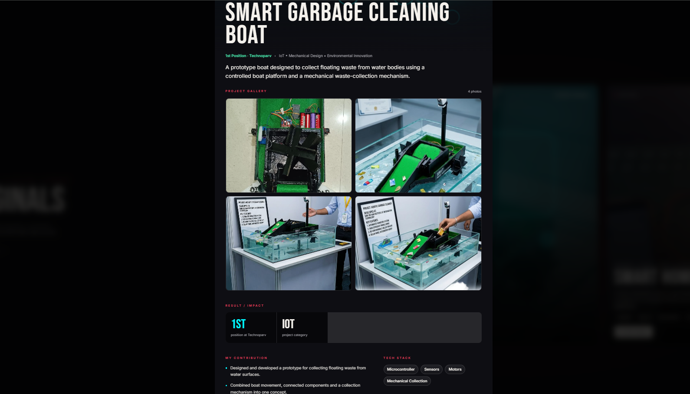

# 🚤 Smart Garbage Cleaning Boat

An IoT-based boat that collects floating garbage from water using a motorised conveyor belt, controlled over WiFi, with a live camera view in the browser.

## 📌 Problem
[your have to use a external 3.5V battery to operate the convaer belt , and 12V bateer is youed for other components "]

## 💡 Solution
The boat is driven by two propeller motors and picks up garbage with a conveyor belt. An ESP32 handles the controls, and an ESP32-CAM streams live video so the boat can be operated remotely.

## 🔧 Components Used

| Qty | Component | Purpose |
|-----|-----------|---------|
| 1 | ESP32 (DevKit) | Main controller |
| 1 | ESP32-CAM (AI-Thinker) | Live video streaming |
| 1 | L298N motor driver | Drives the two propeller motors |
| 2 | DC motors with propellers | Forward / backward / left / right |
| 1 | DC motor | Conveyor belt |
| 1 | Relay module (1-channel) | Switches the conveyor motor ON/OFF |
| 1 | Small battery ([voltage, e.g. 3.7V]) | Powers the conveyor motor only |
| 1 | [Battery pack, voltage] | Powers the L298N / propeller motors |
| 1 | [Power source for ESP32 and ESP32-CAM, e.g. 5V power bank] | Powers the controllers |
| 1 | Jumper wires, [optional: 1N4007 diode] | Connections |

## ⚙️ How It Works
1. ESP32 connects to WiFi and hosts a control web page.
2. Open the ESP32's IP address in Chrome on a phone or laptop to get Forward / Back / Left / Right / Stop buttons and a conveyor ON/OFF button.
3. Two propeller motors are driven through the L298N. Turning is done by running the two motors in opposite directions.
4. The conveyor motor runs on its own battery. The ESP32 switches it through a relay.
5. The ESP32-CAM runs a separate web server. Open its IP address in Chrome to watch the live camera feed (it can also be embedded in the control page).
6. Failsafe: if no command is received for 1 second, the propeller motors stop automatically.

## 🔌 Circuit Connections

> ⚠️ Power everything OFF while wiring. Double-check every connection before switching on. Keep all electronics inside a waterproof enclosure, away from water.
> **All grounds (GND) of the ESP32, L298N and relay module must be connected together (common ground).**

### Block diagram

```
 Phone / Laptop (Chrome)
        │  WiFi
        ▼
 ┌───────────────┐  GPIO 27,26,25,33,14,32  ┌────────┐   OUT1/OUT2   Left propeller motor
 │     ESP32     │─────────────────────────►│ L298N  │──────────────►
 │ (controller)  │                          └────────┘   OUT3/OUT4   Right propeller motor
 │               │  GPIO 23   ┌────────┐ COM/NO  ┌──────────────────┐
 │               │───────────►│ RELAY  │────────►│ Conveyor motor   │◄── Conveyor battery
 └───────────────┘            └────────┘         └──────────────────┘

 ┌───────────────┐  WiFi (live video)
 │   ESP32-CAM   │──────────────────────► Phone / Laptop (Chrome)
 └───────────────┘  (no wire to the main ESP32)
```

### 1. ESP32 → L298N motor driver

| ESP32 pin | L298N pin | Function |
|-----------|-----------|----------|
| GPIO 27 | IN1 | Left motor direction |
| GPIO 26 | IN2 | Left motor direction |
| GPIO 25 | IN3 | Right motor direction |
| GPIO 33 | IN4 | Right motor direction |
| GPIO 14 | ENA | Left motor enable |
| GPIO 32 | ENB | Right motor enable |
| GND | GND | Common ground |

**Important:** remove the two small jumper caps on the ENA and ENB pins of the L298N, then connect ENA and ENB to the ESP32 pins above. (The code keeps them HIGH, so the motors run at full speed.)

### 2. L298N → motors and battery

| L298N terminal | Connect to |
|----------------|------------|
| OUT1, OUT2 | Left propeller motor (2 wires) |
| OUT3, OUT4 | Right propeller motor (2 wires) |
| 12V (motor supply) | Propeller motor battery **+** ([voltage]) |
| GND | Propeller motor battery **−** **and** ESP32 GND |

If a motor spins in the wrong direction, swap its two wires (or swap the IN pins in the code).

### 3. ESP32 → relay module

| ESP32 pin | Relay module pin |
|-----------|------------------|
| GPIO 23 | IN (signal) |
| 5V / VIN | VCC |
| GND | GND |

Most relay modules are **active-LOW** (the relay switches ON when the signal pin is LOW). The code assumes this. If your relay works the other way round, set `RELAY_ACTIVE_LOW` to `false` in `boat_controller.ino`.

### 4. Conveyor motor circuit (separate battery)

The conveyor motor has its own battery. The relay only switches the **positive** line:

```
 Conveyor battery (+) ──► Relay COM
                          Relay NO ──► Conveyor motor terminal 1
 Conveyor battery (−) ──► Conveyor motor terminal 2
```

- Relay **OFF** → circuit open → conveyor stops.
- Relay **ON** → COM and NO connect → conveyor runs.
- This battery is not connected to the ESP32's ground; the relay keeps the two circuits separate.
- Optional but recommended: put a 1N4007 diode across the motor terminals (stripe/cathode towards the **+** side) to protect the relay from voltage spikes.

### 5. ESP32-CAM

| ESP32-CAM pin | Connect to |
|---------------|------------|
| 5V | 5V supply (stable, at least 1A) |
| GND | Supply GND |

The ESP32-CAM does **not** need any wire to the main ESP32. It streams video over WiFi on its own. A weak power supply is the most common reason for camera reboots, so use a good 5V source.

**Uploading code to the ESP32-CAM** (needs a USB-to-serial FTDI adapter, or an ESP32-CAM-MB programmer board):

| ESP32-CAM | FTDI adapter |
|-----------|--------------|
| 5V | 5V |
| GND | GND |
| U0R | TX |
| U0T | RX |
| GPIO 0 | GND (only while uploading) |

After uploading: disconnect GPIO 0 from GND and press the RESET button.

## ▶️ How to Run
1. Install the Arduino IDE and the **ESP32 board package** (Boards Manager → "esp32" by Espressif).
2. Open `boat_controller/boat_controller.ino`, set your WiFi name and password, select board **ESP32 Dev Module** and upload.
3. Open `esp32_cam_stream/esp32_cam_stream.ino`, set the same WiFi details, select board **AI Thinker ESP32-CAM** and upload.
4. Open the Serial Monitor (115200 baud) for each board and note the IP addresses.
5. (Optional) Put the camera's IP in `CAM_IP` inside `boat_controller.ino` and upload again, so the video appears on the control page.
6. Open the ESP32's IP in Chrome to control the boat. Open the ESP32-CAM's IP to see the live camera.

Phone/laptop and both boards must be on the **same WiFi network**.

## 🛠️ Tech Stack
C++ (Arduino framework for ESP32), HTML/CSS/JavaScript (control page), WiFi + HTTP (WebServer, MJPEG streaming)

## 📸 Demo
[Boat ki photo / video yahan lagao]



## 🧠 Challenges & Learnings
- [Ek real challenge jo tumhe aaya aur kaise solve kiya]
- [Ek cheez jo is project se seekhi]

## 👤 Author
Abhaypratap Sikarwar
[LinkedIn](https://www.linkedin.com/in/abhay-sikarwar-a5b9792b1/)
